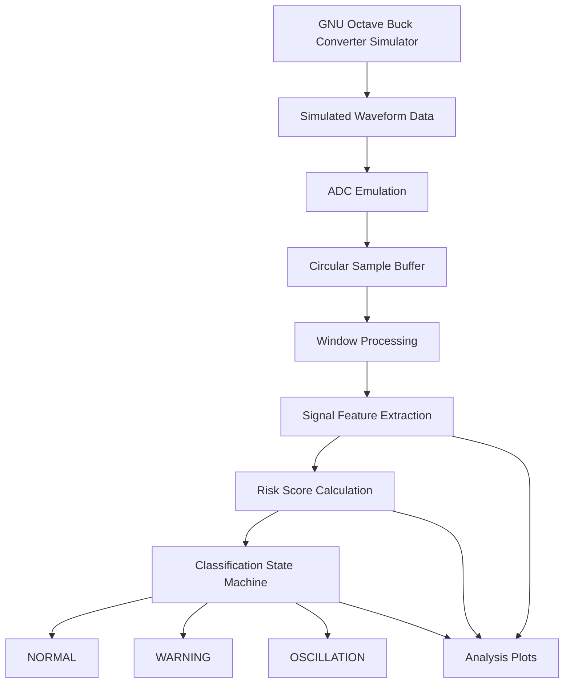
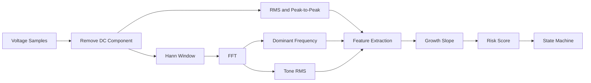
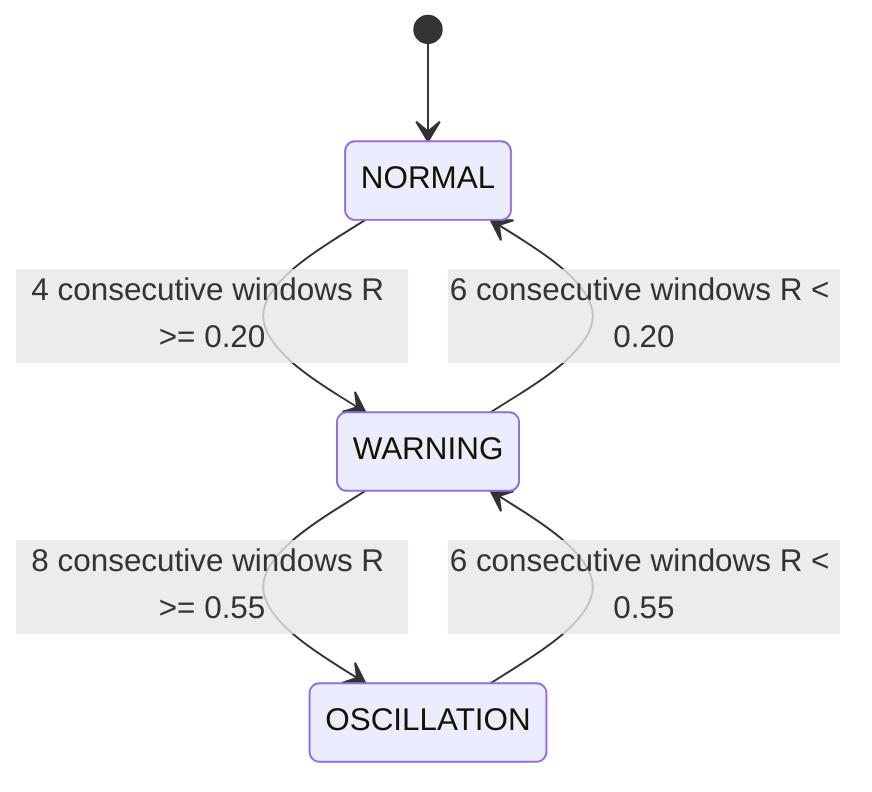

# Predictive Oscillation Detection for Switching Power Regulators

A simulation-driven project for detecting developing oscillatory behaviour in switching power regulators using waveform analysis, frequency-domain features and a multi-stage risk classification system.

The repository contains:
- A GNU Octave averaged buck converter simulator.
- A Python-based oscillation detection prototype.
- Simulated waveform datasets covering five operating scenarios.
- Signal-processing, risk-scoring and state-machine logic.
- Generated plots and analysis results.

> **Scope:** This repository focuses on software simulation and algorithm development. The detector has not been validated on physical hardware.

---

## Table of Contents

- [Overview](#overview)
- [System Architecture](#system-architecture)
- [Repository Structure](#repository-structure)
- [Simulation Model](#simulation-model)
- [Test Scenarios](#test-scenarios)
- [Signal Processing Pipeline](#signal-processing-pipeline)
- [Risk Scoring](#risk-scoring)
- [Classification State Machine](#classification-state-machine)
- [Running the Project](#running-the-project)
- [Implementation Details](#implementation-details)
- [Limitations](#limitations)
- [Future Work](#future-work)

<details>
<summary><strong>What does this project detect?</strong></summary>

A regulator's average output voltage can remain close to its reference value even when its waveform develops oscillations.

Instead of relying only on average voltage, this project analyses sampled output-voltage waveforms to identify abnormal ripple, dominant frequency components and increasing oscillation amplitude.

The detector classifies the observed behaviour into:

- `NORMAL`
- `WARNING`
- `OSCILLATION`

The WARNING state is intended to identify developing abnormal behaviour before it reaches the configured severe-ripple threshold. It is not an exact time-to-failure prediction.

</details>

## Overview

The project uses a simulated voltage-mode PID-controlled buck converter as its development baseline.

The simulator generates output-voltage waveforms under different operating conditions. These waveforms are processed by a Python detector that extracts time-domain and frequency-domain features and calculates an oscillation risk score.

The detector is designed to distinguish ordinary load transients from persistent or progressively developing oscillations.

## System Architecture



### Detection pipeline



## Repository Structure

```text
.
├── buck_sim.m
├── detector.py
├── data/
│   ├── stable.csv
│   ├── transient.csv
│   ├── ringing.csv
│   ├── growing.csv
│   └── oscillation.csv
├── results/
└── README.md
```

| File / directory | Purpose |
|---|---|
| `buck_sim.m` | Simulates the averaged buck converter and generates waveform datasets |
| `detector.py` | Python prototype for waveform processing and oscillation classification |
| `data/` | Simulated datasets for the five operating scenarios |
| `results/` | Generated detector figures and analysis outputs |

CSV datasets use the following columns:

```text
time_s, Vout_V, iL_A, duty, Rload_ohm
```

## Simulation Model

The baseline is an averaged 12 V to 5 V voltage-mode PID-controlled buck converter.

| Parameter | Value |
|---|---:|
| Input voltage | 12 V |
| Output reference | 5 V |
| Switching frequency | 100 kHz |
| Inductance | 100 µH |
| Output capacitance | 220 µF |
| Inductor DCR | 0.05 Ω |
| Nominal load | 10 Ω |
| Nominal output current | 0.5 A |
| Simulation duration | 200 ms |
| Stored waveform sampling rate | 100 kS/s |

The converter model uses a duty-cycle-equivalent switch rather than explicitly simulating every switching transition.

The PID controller includes:
- Proportional control.
- Integral control.
- Filtered derivative control.
- Anti-windup.
- Duty-cycle limits of 0 to 0.95.
- Inductor current limits of -0.5 A to 2.0 A.

The approximate LC resonant frequency is 1.07 kHz.

## Test Scenarios

The simulator generates five datasets to evaluate the detector under different operating conditions.

| Dataset | Operating condition | Expected behaviour |
|---|---|---|
| `stable.csv` | Healthy PID gains and constant load | NORMAL |
| `transient.csv` | Load changes from 10 Ω to 5 Ω at 50 ms, then returns to 10 Ω at 120 ms | Temporary disturbance, generally NORMAL |
| `ringing.csv` | Derivative gain removed, Ki = 80, with the same load changes | Elevated ringing without sustained severe oscillation |
| `growing.csv` | Healthy gains transition to marginal gains between 30 and 130 ms | Developing WARNING condition |
| `oscillation.csv` | Healthy gains become unstable abruptly at 50 ms | OSCILLATION after persistence checks |

The scenarios allow the detector to be evaluated against both temporary disturbances and sustained oscillatory behaviour.

## Signal Processing Pipeline

### 1. ADC emulation

The software prototype emulates a sampled voltage acquisition path.

| Parameter | Value |
|---|---:|
| Sampling frequency | 20 kHz |
| ADC resolution | 12 bit |
| ADC full-scale voltage | 3.3 V |
| Input divider ratio | 0.5 |
| Moving-average filter length | 5 samples |
| Noise | 0.5 LSB RMS Gaussian |
| Quantization range | 0–4095 |

The emulation applies filtering, scaling, clipping, Gaussian noise and quantization before passing samples to the detector.

### 2. Streaming buffer

A circular buffer stores the latest waveform samples.

| Parameter | Value |
|---|---:|
| Buffer size | 128 samples |
| Sampling frequency | 20 kHz |
| Window duration | 6.4 ms |
| Hop size | 64 samples |
| Overlap | 50% |
| FFT bin width | 156.25 Hz |

Each new sample replaces the oldest sample. A processing window is evaluated after every 64 new samples.

### 3. Feature extraction

The detector removes the DC component:

\[
x_{ac}[n] = x[n] - \operatorname{mean}(x)
\]

It then extracts:

- RMS ripple.
- Peak-to-peak ripple.
- Band RMS from 300 to 5000 Hz.
- Dominant frequency.
- Tone RMS around the dominant spectral peak.
- Growth slope of the RMS feature.

A Hann window is applied before the FFT. The detector uses `rfft` and searches for spectral peaks in the 300–5000 Hz band.

Parabolic interpolation around the dominant peak estimates its frequency. Tone RMS is calculated by integrating the peak bin and its two neighbouring bins on either side.

The growth slope is estimated using least-squares regression on the logarithm of RMS values across the latest five windows.

## Risk Scoring

The risk score combines ripple amplitude, dominant-tone energy and the growth of oscillation amplitude.

The detector first calibrates its noise floor using `data/stable.csv`, skipping the first 10 ms.

The noise-floor gate is calculated using the baseline mean plus five standard deviations for RMS ripple and tone RMS. Features below the gate contribute zero score.

The severe-ripple reference is configured as 3% of the 5 V output reference:

\[
V_{\text{threshold}} = 0.03 \times 5 = 0.15\text{ V}
\]

This is a configurable design threshold, not a universal regulatory limit.

The normalized risk components are:

- \(A\): RMS ripple contribution.
- \(E\): dominant-tone RMS contribution.
- \(G\): normalized growth contribution.

The growth term is:

\[
G = \operatorname{clip}\left(
\frac{slope - 0.05}{0.30 - 0.05},0,1
\right)
\]

The final risk score is:

\[
R = 0.4A + 0.4E + 0.2G
\]

The growth contribution is enabled only when the ripple contribution \(A\) is above zero.

The individual components are normalized to a 0–1 range using a logarithmic scale.

## Classification State Machine

The state machine uses threshold persistence and hysteresis to reduce false alarms caused by short-lived disturbances.



### Transition conditions

| Transition | Condition |
|---|---|
| NORMAL → WARNING | 4 consecutive windows with R ≥ 0.20 |
| WARNING → OSCILLATION | 8 consecutive windows with R ≥ 0.55 |
| WARNING → NORMAL | 6 consecutive calm windows with R < 0.20 |
| OSCILLATION → WARNING | 6 consecutive windows with R < 0.55 |

With a 3.2 ms hop size:

- 4 consecutive windows correspond to approximately 12.8 ms.
- 8 consecutive windows correspond to approximately 25.6 ms.
- 6 consecutive windows correspond to approximately 19.2 ms.

Escalation always passes through WARNING. This persistence logic helps reject short transients, while hysteresis reduces rapid switching between states.

### State interpretation

<details>
<summary><strong>NORMAL</strong></summary>

Low ripple and low oscillation energy. No sustained abnormal behaviour is detected.

</details>

<details>
<summary><strong>WARNING</strong></summary>

Abnormal fluctuations or increasing oscillation risk are detected, but the sustained severe condition has not yet been established.

</details>

<details>
<summary><strong>OSCILLATION</strong></summary>

The calculated risk remains above the severe threshold for the required number of consecutive windows.

</details>

## Running the Project

### Requirements

- GNU Octave
- Python 3
- Python packages required by `detector.py`

### Generate simulation datasets

```bash
octave buck_sim.m
```

### Run the detector

```bash
python detector.py
```

The detector processes the simulated waveform datasets and generates analysis outputs.

## Implementation Details

The Python prototype is structured around a streaming detection workflow.

| Prototype operation | Intended embedded equivalent |
|---|---|
| `emulate_adc()` | ADC peripheral, voltage scaling and hardware-timer sampling |
| `CircularBuffer` | Fixed-size 128-sample C array |
| `on_sample()` | Timer ISR or ADC-ready callback |
| `process_window()` | Periodic DSP task |
| `extract_features()` | C implementations of mean, RMS, peak-to-peak and FFT |
| `risk_score()` | Embedded risk-score calculations |
| `StateMachine` | C enum and switch-case |
| Console output | Serial output or a display interface |

The Python implementation serves as an algorithm prototype. It defines the processing sequence, feature calculations, buffer requirements and classification logic for a possible future embedded implementation.

It should not be interpreted as a completed real-time embedded firmware implementation.

## Limitations

- Validation is based on simulation datasets.
- The averaged converter model does not reproduce actual switching ripple.
- ESR, ESL and component tolerances are not fully represented.
- Only a limited set of input and load conditions is considered.
- Risk weights and thresholds are fixed design parameters.
- The detector does not directly measure phase margin.
- The detector monitors and classifies behaviour; it does not automatically stabilize the converter or modify its control loop.

## Future Work

- Port the detection algorithm to an embedded C implementation.
- Evaluate real-time ADC sampling and DSP performance.
- Validate the algorithm using physical converter measurements.
- Explore adaptive thresholds across operating conditions.
- Extend monitoring to temperature and additional electrical parameters.
- Investigate TinyML-based condition classification.
- Explore automatic corrective control as a separate extension.

---

## References

- Erickson, R. W., and Maksimović, D. *Fundamentals of Power Electronics*.
- Meeks, D. Texas Instruments Application Report SLVA301 (2008), *Loop Stability Analysis of Voltage Mode Buck Regulator with Different Output Capacitor Types – Continuous and Discontinuous Modes*.
